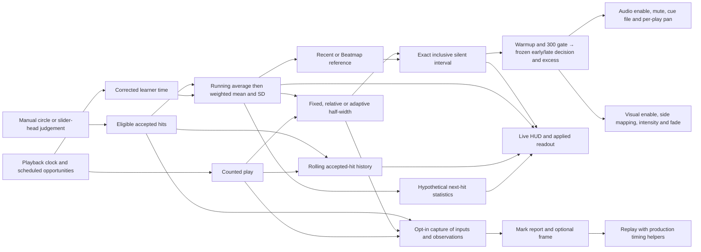

# Timing audio system map

Open **Options → Timing Audio Experiment**, the first section. **Applied Timing Setup** reports the game's current values. The [control reference](timing-audio-controls.md) lists every experiment setting and inherited bar control with its exact key, default, range, and persistence. Configurable timing is implemented in the source revision containing this map. Deployment and player acceptance are recorded separately with the build revision.

The optional [live timing debug capture](timing-capture.md) records the timing model inputs and observed results at the adapter boundary. A mark saves a bounded prefix and current applied snapshot. The optional screenshot records the following matching draw. Capture settings are ordinary Options preferences outside named audio profiles.

[Performance capture](performance-capture.md) uses the same mark independently of timing audio. It records completed app update intervals and CPU-side phases, and exports them with the timing report and optional image through the bounded Windows worker.

[Peripheral timing cues](peripheral-timing-cues.md) use the same hit decision as audio. Either channel can keep the shared learner active. Visual styling and side mapping are independent of audio routing.

## From input to a cue

1. **Eligibility.** Standard gameplay sends manual 300, 100 and 50 circle/slider-head hits. Misses, misaims, strays, bodies, tails and spinners are outside this observation path. Auto, Relax, Autopilot, VR and secondary instances are excluded. Invalid timing samples (nonfinite error, invalid window or invalid rate) are rejected. A valid observation still updates timing when a cue is gated or muted, or when the chosen reference cannot resolve. Eligibility follows the gameplay seam and changes neither scoring nor judgement. [Beatmap judgement dispatch](../src/App/Osu/OsuBeatmap.cpp), [adapter and eligibility](../src/App/Osu/OsuTimingAudioFeedback.cpp)
2. **Two clocks.** The learner uses real-play time derived from map position and rate. A qualifying scheduled rest is removed in full from that clock. Include slider bodies and spinners as scheduled activity, or use the **Long bodies/spinners count as breaks** switch to consider circle/head opportunities only. A hit can arrive early enough to qualify a rest before the music clock reaches the opportunity. **Restart after breaks** also controls learner restart on pause. The separate counted-play clock ages the idle band and rolling history through real rests, misses and other gameplay with no accepted hit. It freezes on pause, loading, countdown and scheduled continue. Ready accepted pre-roll hits are timestamped before the counted clock starts. Backward clock corrections use a high-water mark. Nonfinite timestamps break continuity. Explicit seek, retry and disabling both cue channels reset the playback clock and history. Empty-section skip preserves both and adds no virtual play time. Its music-position jump goes through the existing learner gap policy. Learner-only resets preserve rolling observations. [Gap handling](../src/App/Osu/OsuTimingAudioState.h), [counted play](../src/App/Osu/OsuTimingAudioPlayClock.h), [game hooks](../src/App/Osu/OsuBeatmap.cpp)
3. **Learning and reference.** The startup running average gives equal weight to the first configured number of accepted hits. Thereafter the same population moments use either active seconds or accepted hit count for exponential weighting. One accepted hit establishes a mean. Two are required for a population SD display and the learned adaptive width. A time-weighted hit at the same effective learner time can have zero weight and still be accepted. Recent reference uses the preceding learned mean. Beatmap reference selects center or signed 300, 100 and 50 edges, with fractional targets interpolated. Rate and judgement windows determine the units. Changing reference preserves learning. Changing estimator, half-life, startup averaging or break detection resets it. [State and weighted moments](../src/App/Osu/OsuTimingAudioState.h), [reference and endpoints](../src/App/Osu/OsuTimingAudioReference.h)
4. **Width and idle.** Fixed is a real-play millisecond half-width. Map-relative uses a fraction of the current 300 half-window. Adaptive scales the learned SD and clamps it to its configured minimum and maximum. Its first two hits use fixed width by default. The independent **Adaptive startup uses maximum** switch uses the configured cap for those two hits when bounds are valid. With idle widening off, unusable learned adaptive statistics fall back to fixed width. With idle widening on, unusable learned statistics make the band unavailable. A finite zero SD is valid. [Shared width resolver](../src/App/Osu/OsuTimingAudioState.h)
5. **Classify, learn, recover.** After scheduled opportunity qualification, the model classifies against the pre-hit interval. Endpoints are inclusive. An outside hit is early or late relative to the target. The **300 gate** requires the preceding baseline inside the actual 300 window for either reference. Recent additionally requires a mean and can require a configurable number of accepted hits before sounding. A Recent warmup of zero still requires a mean. Once the hit is accepted it updates learning and uses a step of idle recovery, even during gate or mute. [Classifier and readiness](../src/App/Osu/OsuTimingAudioState.h)
6. **Output.** Early and late select separate files from `sounds/`. The cue gain is multiplied by Master volume, including the inactive Master level where applicable. Effects gain does not apply. Immediate mute and zero gain preserve learning. If a replacement cannot load, **Keep last good cue** selects a previous ready sample for that direction when available. Turning it off makes that direction silent. Retry attempts the file again, including edits under the same filename. Device recovery reloads owned resources. Preview buttons play a draft file with draft gain through the preview path. Separate resource ownership, release, overlayable cues and backend playback success are operational rules. The readout distinguishes pending files, retained files, unavailability, and a failed sound request. [Resource adapter](../src/App/Osu/OsuTimingAudioFeedback.cpp), [preview and file chooser](../src/App/Osu/OsuTimingAudioOptions.cpp)

### Idle widening and recovery

In **Adaptive spread** with **Widen adaptive band during idle** enabled, the effective half-width is the ordinary clamped half-width plus the idle allowance times the distance to the cap. The allowance starts increasing after the grace period and reaches the cap after one full ramp from zero. A zero grace permits widening after any positive elapsed time. A zero ramp reaches the cap immediately after grace. Each accepted hit uses the pre-hit allowance, then subtracts one divided by the recovery hit count, floors it at zero, and starts a new grace interval. Misses consume no recovery. A subsequent rest starts from the retained allowance.

Fixed startup enters the learned phase with zero allowance. Maximum startup with idle enabled starts hit two at the cap and leaves one recovery step used. Toggling into idle widening after learning starts a new grace interval with zero allowance. Editing grace and ramp reinterprets elapsed time from the current anchor. Editing recovery changes the next step. Width and limits can change while learning continues. The live interval describes current known state. A future hit can first qualify an early-return rest and change the state used to classify it.

With the trial defaults, a mature learner starting at zero reaches its cap after four counted-play seconds. The first returning hit uses the cap and leaves 75% allowance. Three more accepted hits inside grace remove it, including simultaneous hits. In a sparse pattern, a second long rest can restore allowance between accepted hits. Pausing freezes the clock even if the restart policy clears the learner. Retry clears both clocks and rolling observations. For A/B, switch idle off and select fixed adaptive startup to recover the previous adaptive policy, or use immediate mute for a silent trial that retains the learner.

## What the HUD and copied report show

- The **Audio estimate** statistics are current learned mean and population SD. **Recent window** uses accepted observations within the selected counted-play duration, regardless of the current audio reference. The latest 2,048 observations are retained. At the exact duration boundary a hit ages out, and a window that lost hits to capacity is marked truncated. The two **Projected** choices assume one next hit at the learned average or current audio reference with the current estimator. They consume no observations, do not predict a particular future opportunity, and are not observed improvement or confidence intervals. [Rolling history](../src/App/Osu/OsuTimingAudioRecentWindow.h), [projections](../src/App/Osu/OsuTimingAudioState.h)
- The default white marks use the selected statistics. The default yellow tick and cyan strip use the actual audio reference and exact current interval. Smooth duration affects statistics only. Caption, markers-only, interval visibility, tick visibility, overlay opacity, caption scale, stroke scale and colors are adjustable. Base hit-error-bar visibility, spinner hiding, opacity, placement and judgement window affect the overlay. Global HUD scale and Shift+Tab behaviour remain ordinary game options. Clipping, one upright caption, a minimum visible stroke, fixed outline/backplate contrast and keeping the caption in the viewport are rendering rules. [HUD geometry](../src/App/Osu/OsuTimingAudioHUD.h), [renderer](../src/App/Osu/OsuHUD.cpp), [HUD controls](../src/App/Osu/OsuTimingAudioHudControls.h)
- **Copy applied timing setup** reports all registered settings, underlying HUD and Master dependencies, current reference and rate, raw/ordinary/cap/effective widths, allowance, mean and SD, accepted count, two clocks, last-hit age, pending reset, and the last evaluated interval and output. Current width describes the next comparable hit. Last-hit geometry describes the pre-update evaluation of that hit. Settings values preserve the stored text. The in-game version is reported from McOsu's version field. Software verification and release records identify the exact Git/build revision. Options refreshes its compact labels at most four times a second. Copy takes a fresh read-only snapshot. [Readout](../src/App/Osu/OsuTimingAudioSetup.h), [Options and clipboard](../src/App/Osu/OsuTimingAudioOptions.cpp)

## Applying, saving and maintaining the map

The [supported verification command and coverage map](verification.md) run the
nine timing/HUD helper suites, settings inventory and historical pre-roll case.
Their receipts establish software state/geometry boundaries; native rendering,
input, audio and human usefulness remain separate checks.

Audio changes in the editor take effect after Apply or Ctrl+Enter. Closing discards unapplied edits. The immediate mute button and HUD options update current settings directly. Hover a numeric label or control to see its effect and, for draft audio fields, its range, Apply behavior and any inactive dependency. Opening Options or changing the search does not rewrite HUD values. Apply validates a full batch before writing any audio value. Named profiles include the applied audio settings, including mute, startup, idle and failed-cue policy. HUD settings save with Options and stay outside audio profiles. Loading an older audio profile fills only recognized new keys with their registered original-behaviour defaults. Unknown, duplicate, invalid or otherwise incomplete profiles are rejected as a whole. Saving over a name or deleting requires a second matching action within ten seconds. Standalone timing settings are saved with their applied values. Retained compound commands keep their original text and run before those settings. [Schema and profile parser](../src/App/Osu/OsuTimingAudioSettings.h), [Options save](../src/App/Osu/OsuOptionsMenu.cpp)

Update this map in the same change as timing behaviour, controls/defaults, dependencies, clocks/resets, persistence, cue output or HUD changes. Regenerate the [control reference](timing-audio-controls.md) with `python tests/check-timing-audio-settings.py --write-docs`, then run it without the flag to check registration, metadata and the tracked reference. The source owner updates conceptual edges and lifecycle explanations. The bench reviews them against the frozen source revision, and build evidence ties that revision to the actual package or deployment.
